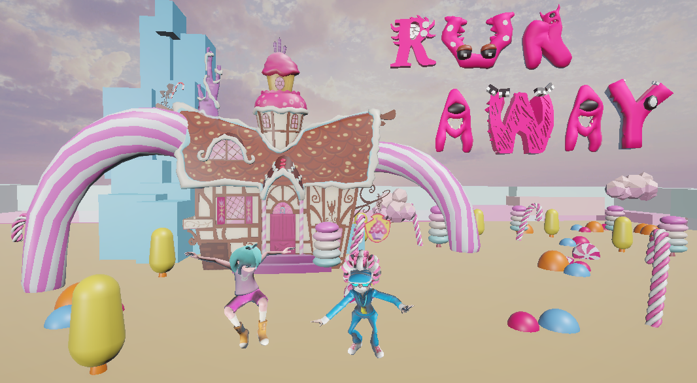

# Runaway

> 마녀에게 납치된 친구를 구하기 위해 과자 나라를 탈출하는 3D 액션 어드벤처 게임

### [🎮 브라우저에서 바로 플레이하기](https://hnkim-works.github.io/runaway-webgl/)

## 프로젝트 소개

**Runaway**는 마녀의 공격과 장애물을 피하며 과자를 모아 친구를 구하는 게임입니다.  
두 개의 스테이지를 통과한 뒤 마녀를 쓰러뜨리면 친구를 구출할 수 있습니다.

| 항목 | 내용 |
| --- | --- |
| 개발 형태 | 1인 개발 |
| 개발 기간 | 약 2주 |
| 개발 환경 | Unity 6000.0.39f1 · C# |
| 플랫폼 | WebGL |
| 담당 | 기획, 게임 로직, UI, 애니메이션 연동, 레벨 구성, 배포 |

## 플레이 방식

- 방향키로 이동하고 `Space`로 점프합니다.
- Stage 1에서 과자 **10개**, Stage 2에서 **15개**를 모아야 합니다.
- 마녀의 구슬과 움직이는 전깃줄에 닿으면 목숨이 감소합니다.
- 마지막 스테이지의 조건을 달성하면 마녀를 공격해 친구를 구할 수 있습니다.

## 주요 구현

- `CharacterController` 기반 이동·점프와 애니메이션 상태 전환
- 무작위 위치에 생성되는 과자와 스테이지별 수집 목표
- Animation Event를 활용한 마녀의 투사체 공격
- 하트 UI, 피격 효과, 게임 오버 및 재시작 흐름
- Cinemachine·Timeline 도입 컷신과 페이드 장면 전환
- `Mathf.PingPong`을 활용한 이동 장애물과 배경 연출
- WebGL 빌드 및 GitHub Pages 배포

## 기억에 남는 문제 해결

### 자식 Collider 때문에 수집이 인식되지 않던 문제

플레이어 태그는 최상위 오브젝트에 있었지만 실제 충돌은 자식 Collider에서 발생해 과자가 집계되지 않았습니다. 충돌한 대상의 `transform.root`를 기준으로 태그를 확인하도록 변경해 수집과 피격 판정을 정상화했습니다.

### 보스의 Collider가 투사체를 방해하던 문제

마녀에게 피격 Collider를 추가하자 자신이 발사한 구슬과 간섭했습니다. 평소에는 Collider를 끄고, Stage 2 목표를 달성한 순간에만 활성화해 기존 공격 패턴과 보스전을 함께 유지했습니다.

## 제작 과정에서 배운 점

기획부터 WebGL 배포까지 하나의 플레이 흐름을 완성하며 오브젝트 계층 구조, 물리 충돌, 씬별 상태 관리가 서로 밀접하게 연결된다는 점을 배웠습니다.

## 리소스 안내

캐릭터·애니메이션과 일부 환경, 사운드는 Mixamo, Unity Asset Store, Sketchfab, Pixabay의 리소스를 활용했습니다. 각 리소스의 저작권은 원저작자에게 있으며 본 게임은 학습 목적으로 제작되었습니다.
